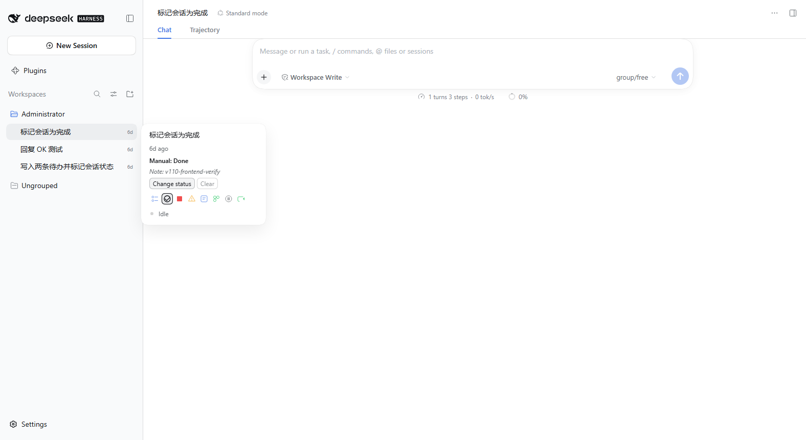
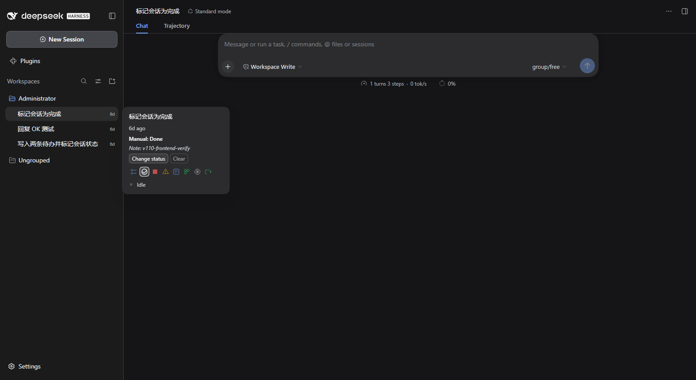

# dsh-session-status-marker

给 DeepSeek Harness 的会话打状态标记。侧栏每个会话行后面显示一个小图标，一眼就能看出这个会话是待办、已完成、被中断，还是卡住了。状态可以你自己点选，也可以让 AI 在任务结束时自动标。



## 怎么用

**手动标记**：鼠标移到侧栏的会话行上，卡片里会出现八个状态格子。点一下就设好，也可以写一句备注。

**跨会话总览**：打开设置面板，左侧出现「会话状态」一节。它按状态分组列出所有打过标记的会话，每组带数量，组内按更新时间排序，页面里自动刷新。

**让 AI 自己标**：插件给模型提供 `set_session_status` 和 `clear_session_status` 两个工具。任务被中断、子代理还没跑完、需要你回答时，模型可以自己标上。手动标记的优先级高于自动推断，自动推断不会覆盖你标过的状态。

## 八种状态

| 状态 | 图标 | 用在哪 |
|---|---|---|
| `todo` | 清单 | 会话停止输出了，但还有事情没做完 |
| `done` | 对勾 | 任务已经完成 |
| `stopped` | 停止 | 会话被中断，任务没有做完 |
| `blocked` | 警告三角 | 卡住了，需要人来处理才能继续 |
| `review` | 浏览 | 产出已经完成，等你审查 |
| `pending-subagent` | 子代理 | 子代理还在运行，父会话在等它 |
| `awaiting-answer` | 暂停 | 在等你回答问题或做选择 |
| `feedback` | 点赞 | 需要你给反馈 |

## 安装

**从 npm 安装**（当前版本 1.1.3）：

```bash
dsh plugin --profile desktop add dsh-session-status-marker
```

**从 GitHub Release 安装**：到 <https://github.com/sterraMind/dsh-session-status-marker/releases> 下载 `dsh-session-status-marker-1.1.3.tgz`，然后：

```bash
dsh plugin --profile desktop add ./dsh-session-status-marker-1.1.3.tgz
```

装完核对一下是否生效：

```bash
dsh --profile desktop --dump-config   # 输出里应出现 session-status-marker
```

要求 DeepSeek Harness 版本在 `0.2.0-rc.2` 到 `0.3.0` 之间，Node 版本 24.9.0 或更高。

## 配置

在 profile 的 `cordis.patch.yml` 里写配置。前三项必填，`refreshIntervalMs` 有默认值可以省略：

```yaml
- id: session-status-marker
  name: dsh-session-status-marker
  config:
    autoInfer: true            # 是否允许 AI 自动推断状态
    maxNoteLength: 200         # 备注最长字符数
    autoExpireMs: 0            # 自动标记多久后过期，0 表示不过期
    refreshIntervalMs: 2000    # 浏览器多久读一次状态，最小 250
```

## 主题与语言

界面跟随 DeepSeek Harness 的浅色、深色和跟随系统三种主题。侧栏徽标、状态总览、悬停卡片都使用同一套主题颜色，浅色主题下卡片是白底深色字，深色主题下是深灰底浅色字。



界面文字支持八种语言：简体中文、英文、日文、西班牙文、法文、德文、俄文、葡萄牙文。跟随 Harness 当前的语言设置。

## 已知限制

- 浏览器端靠定时读取来发现其它窗口或 AI 写入的状态，不是服务端实时推送，因此最多有一个轮询周期的延迟（默认 2 秒）。
- 日文、西班牙文、法文、德文、俄文、葡萄牙文的界面文字只经过字典完整性测试，没有在真实页面里逐种语言看过。
- 终端界面（TUI）没有状态徽标的显示位置，标记只能由 AI 写入并以文字形式呈现，界面接入还没做。
- 侧栏按状态筛选、批量修改多个会话的状态，这两项还没做。

## 开发

源码和完整文档在 GitHub：<https://github.com/sterraMind/dsh-session-status-marker>

```bash
pnpm run typecheck     # 类型检查
pnpm run build         # 编译 Host 与浏览器端产物
pnpm run test          # 73 项测试
pnpm pack              # 打包成 .tgz 压缩包
```

这个插件作为独立安装包加载，不修改 DeepSeek Harness 自身的源码。状态数据保存在 DSH 宿主侧的数据文件里，不写进会话日志，因此不会占用对话上下文，也不会影响模型输入。

需要了解实现细节、设计决策和测试证据时，请看仓库里的文档：

- [架构设计](https://github.com/sterraMind/dsh-session-status-marker/blob/main/docs/architecture.md)
- [验收与回归测试](https://github.com/sterraMind/dsh-session-status-marker/blob/main/docs/acceptance-and-regression.md)
- [项目记忆与经验教训](https://github.com/sterraMind/dsh-session-status-marker/blob/main/docs/project-memory.md)
- [调研与设计文档总目录](https://github.com/sterraMind/dsh-session-status-marker/tree/main/docs)

## 许可

MIT，与 DeepSeek Harness 一致。
